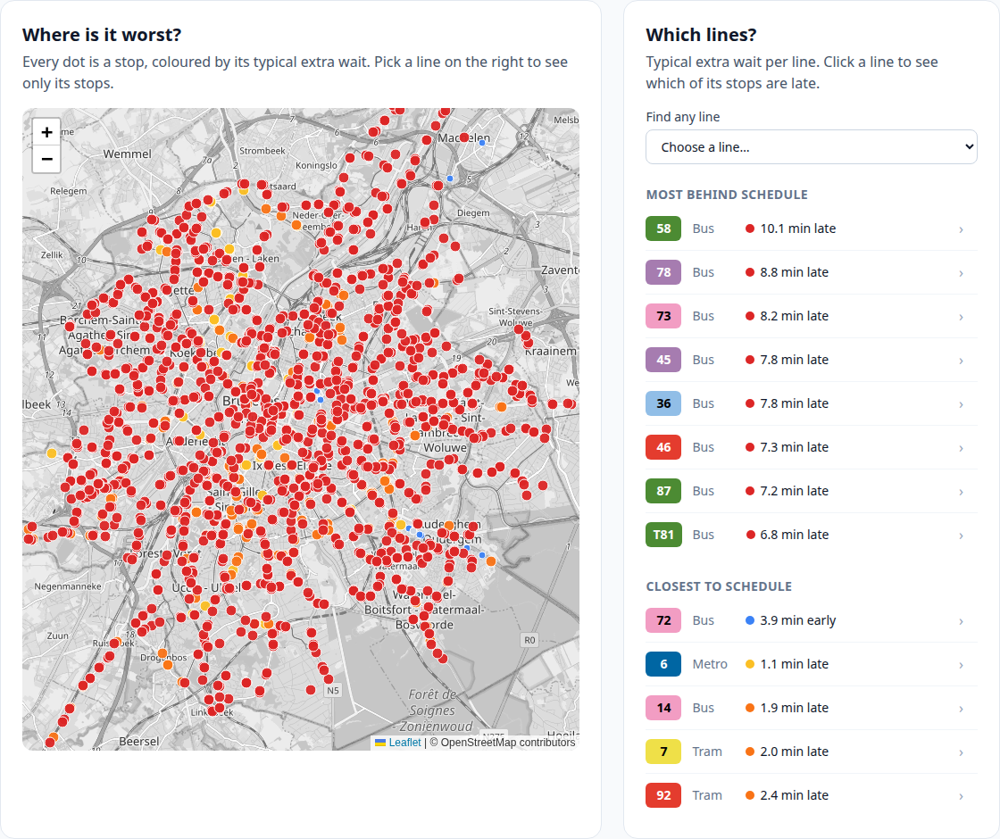
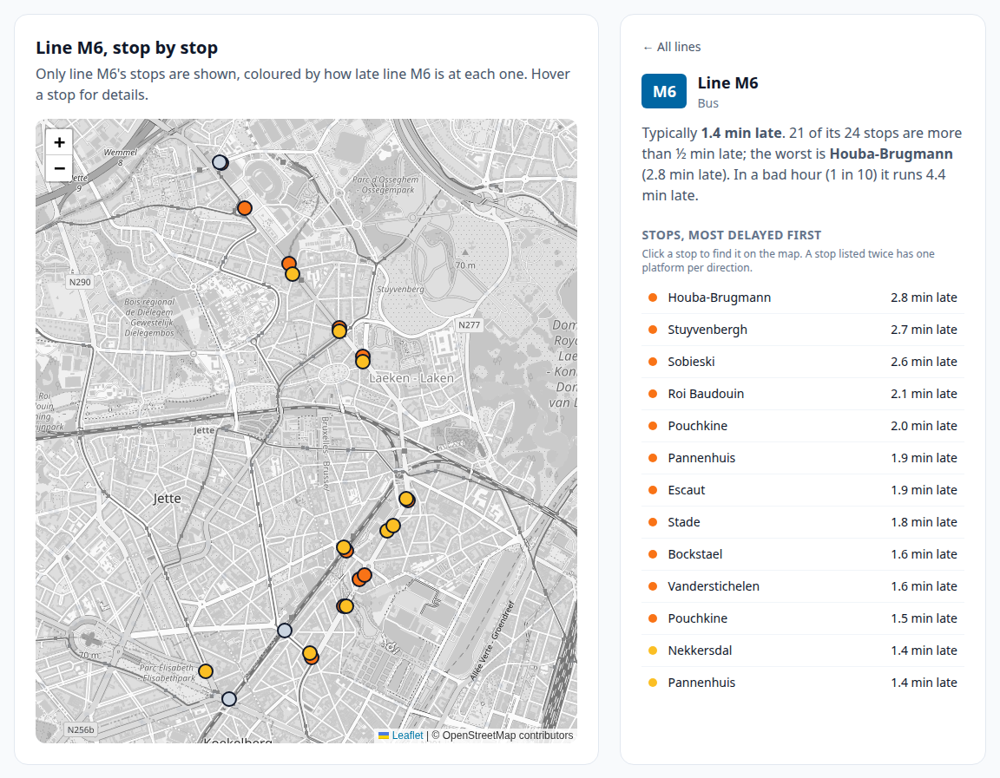
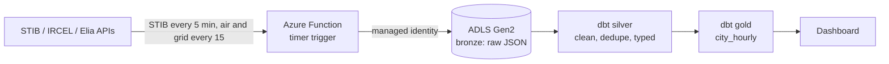

# Brussels open-data lakehouse

Every 5 minutes this pipeline collects Brussels public-transport, air-quality and electricity data on Azure, and turns it into clean hourly tables and a public dashboard.

**Live dashboard:** https://lakehouse.jwds.me (rebuilt every hour; also served straight from Azure at https://belakehouselake.z1.web.core.windows.net/)


The page answers in plain words whether STIB is on time right now, shows the extra wait per hour for metro, tram and bus, the worst hours of the day, a map of every stop coloured by delay, and the lines furthest behind. Click a line to see which of its stops are late. Air quality, grid load and the full hourly table (with CSV download) sit below.

The screenshots are from the morning of Tuesday 13 October 2026, after a day when almost nothing ran on time. On Monday 12 October people waited a median 4.7 minutes longer than the timetable promised across Brussels, in 19 of 22 measured hours more than 3 minutes. Bus was worst (+5.3 min median), tram +3.0, metro +2.0. Of 68 lines, 58 were more than 3 minutes behind and 29 more than 5; 84% of the 1,634 stops were red. Bus 58 ran 10.1 minutes late at a typical stop, 21.5 minutes in a bad hour, at every one of its 40 stops. Only bus 72 ran early.

| Every stop, coloured by delay | Click a line: its stops, worst first |
|---|---|
|  |  |

**Sister project:** [Brussels Live](https://live.jwds.me) ([code](https://github.com/Huntsama/brussels-live)) shows every STIB vehicle moving on a map right now. This lakehouse feeds it a small data product, `lines.json` (how late each line usually is, hour by hour), so the live map can say "line 71 is usually 2 min late at this hour". History here, live there.

The question it answers:

> How much longer do people wait for a STIB metro, tram or bus than the timetable promises, how polluted is the air, and how much power is Belgium using, hour by hour?

## Sources (all open, no key)

| Source | What | How often |
|---|---|---|
| [STIB-MIVB](https://data.belgianmobility.io/) | live vehicle positions, waiting times at ~900 stops, 2,458 stop locations | real time, so we keep snapshots |
| STIB timetable (GTFS) | every scheduled departure (~485k for two service days) | weekly |
| [IRCEL-CELINE](https://geo.irceline.be/sos/api/v1/) | NO₂, PM10, PM2.5 at 13 Brussels stations | hourly |
| [Elia](https://opendata.elia.be/) | Belgian grid load (MW) | 15 min |

## Architecture



- **Bronze**: each API answer saved untouched as gzipped JSON, partitioned by `source/date=YYYY-MM-DD/HHMMSS.json.gz`.
- **Silver** (`transform/models/silver`): one tidy table per source. Overlapping snapshots are de-duplicated, latest revision wins.
- **Gold**:
  - `stop_line_hourly`: **Excess Wait Time** per stop, line and hour, the punctuality measure Transport for London uses for frequent services. Actual wait (minutes to the next vehicle at a random moment, from our snapshots) minus scheduled wait (`Σh² / 2Σh` over timetable headways).
  - `city_hourly`: one row per hour with median wait, excess wait, vehicles in service, NO₂/PM and grid load.
- **Tests**: pytest for the ingest, dbt tests (not null, unique, accepted values, value ranges) on every model. CI runs both on a small sample.
- **Infra as code**: `infra/main.tf` creates the data lake, the Function app (Flex Consumption), its role assignments and a $10/month budget alert.

## Analysis

`uv run python -m lakehouse.analysis` prints excess wait by mode, by line and by hour of day, and correlates it with air quality and grid load (raw, and with the daily rhythm removed so rush hour isn't mistaken for a link).

First look (13 hours, Fri 10 Oct 2026): metro +0.5 min over its timetable, tram +0.4, bus +0.4; bus 75 and tram 35 furthest behind.

First full day (Mon 12 Oct 2026, 22 hours): a different picture. Citywide median excess wait +4.7 min, peaking at +6.1 min at 20:00. Bus +5.3 min, tram +3.0, metro +2.0 (metro 2 alone +5.6). 58 of 68 lines more than 3 min behind; the worst eight are all buses: 58 (+10.1), 78 (+8.8), 73 (+8.2), 45 and 36 (+7.8), 46 (+7.3), 87 (+7.2), T81 (+6.8). By hour of day the delay climbs from +2 min at 04:00 to over +5 min from 11:00 and stays there until the last vehicles.

First full week (Tue 13 to Sun 18 Oct 2026, 1,800 snapshots, 9.6M arrival predictions): Monday turned out to be the exception. On a normal day the wait is barely longer than the timetable promises: metro +0.47 min, bus +0.39, tram +0.38. Only 3 of 87 lines run more than a minute behind at a typical stop (T81 +1.4, 46 +1.4, 69 +0.9), and 17 run slightly early. The worst moment of a weekday is the first hour of service (+2.6 min at 04:00), then the evening rush (+0.8 at 16:00). Weekends are calmer still (Sat +0.28, Sun +0.15).

STIB's own countdowns, followed snapshot by snapshot up to the arrival, are off by about a minute: 0.9 min on average five minutes ahead, 1.1 min fifteen minutes ahead. The vehicle usually comes later than shown (+0.3 min), never earlier on average. That steady lateness is the next thing to learn: a model trained on this week should beat the countdown it starts from.

## Field notes

What the data actually looked like, and the problems on the way, in [`notes/`](notes/):
[STIB API](notes/01-stib.md) · [IRCEL and Elia](notes/02-air-and-grid.md) · [GTFS timetable](notes/03-gtfs.md) · [Excess Wait Time](notes/04-excess-wait.md) · [Azure deployment](notes/05-azure.md)

## Run it locally

```bash
uv sync --group dev
uv run python -m lakehouse.ingest          # one snapshot into data/bronze
uv run python -m lakehouse.ingest stops    # stop list (weekly is enough)
uv run python -m lakehouse.ingest gtfs     # timetable (weekly)
uv run dbt build --project-dir transform --profiles-dir transform
uv run pytest -q
uv run python -m lakehouse.report          # dashboard -> site/index.html
uv run python -m lakehouse.analysis        # the studies above, printed as tables
```

## Deploy to Azure

```bash
cd infra
cp terraform.tfvars.example terraform.tfvars   # your subscription id and email
az login
terraform init && terraform apply
cd .. && func azure functionapp publish func-belakehouse
```

## Limits

- STIB publishes no history, so delays can only be measured from the snapshots this pipeline has collected.
- Actual wait uses STIB's live prediction of the next arrival, not a measured arrival. Excess wait is only as good as that prediction.
- About 24% of live stop IDs have no exact match in the GTFS timetable, so those stops are left out of excess wait.
- Elia's measured load arrives with about a day of delay; the latest hours are empty until it does.
- Brussels air is averaged over all stations; per-commune values need a stop-to-station mapping.

## Status

- [x] Ingest STIB, IRCEL and Elia into bronze
- [x] dbt silver and gold with tests, CI
- [x] Terraform for Azure (lake, function, budget)
- [x] Excess Wait Time vs the GTFS timetable
- [x] Deployed on Azure (Germany West Central), STIB snapshots every 5 min, air and grid every 15
- [x] Public dashboard, rebuilt hourly by GitHub Actions
- [x] Analysis script: by mode, by line, by hour, correlations
- [x] `lines.json` data product, read by the Brussels Live map
- [x] One week of data (12 to 18 Oct 2026)
- [ ] Correlation study written up
- [ ] Machine learning: excess wait per stop and hour, and a correction for STIB's countdown
- [ ] Power BI / Fabric report
