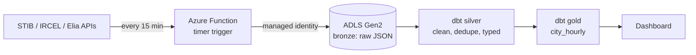

# Brussels open-data lakehouse

Every 15 minutes this pipeline collects Brussels public-transport, air-quality and electricity data, and turns it into one clean hourly table:

> How long do you wait for a STIB tram or bus, how polluted is the air, and how much power is Belgium using, hour by hour?

## Sources (all open, no key)

| Source | What | How often |
|---|---|---|
| [STIB-MIVB](https://data.belgianmobility.io/) | live vehicle positions, waiting times at ~900 stops, 2,458 stop locations | real time, so we keep snapshots |
| [IRCEL-CELINE](https://geo.irceline.be/sos/api/v1/) | NO₂, PM10, PM2.5 at 13 Brussels stations | hourly |
| [Elia](https://opendata.elia.be/) | Belgian grid load (MW) | 15 min |

## Architecture



- **Bronze**: each API answer saved untouched, partitioned by `source/date=YYYY-MM-DD/HHMMSS.json`.
- **Silver** (`transform/models/silver`): one tidy table per source. Overlapping snapshots are de-duplicated, latest revision wins.
- **Gold** (`transform/models/gold/city_hourly.sql`): one row per hour with median wait, vehicles in service, NO₂/PM and grid load.
- **Tests**: pytest for the ingest, dbt tests (not null, unique, accepted values, value ranges) on every model. CI runs both on a small sample.
- **Infra as code**: `infra/main.tf` creates the data lake, the Function app (Flex Consumption), its role assignments and a $10/month budget alert.

## Run it locally

```bash
uv sync --group dev
uv run python -m lakehouse.ingest          # one snapshot into data/bronze
uv run python -m lakehouse.ingest stops    # stop list (weekly is enough)
uv run dbt build --project-dir transform --profiles-dir transform
uv run pytest -q
```

## Deploy to Azure

```bash
cd infra
cp terraform.tfvars.example terraform.tfvars   # your subscription id and email
az login
terraform init && terraform apply
cd .. && func azure functionapp publish func-belakehouse
```

## Limits

- STIB publishes no history, so delays can only be measured from the snapshots this pipeline has collected.
- "Wait time" is STIB's own prediction, not the scheduled timetable. Comparing it with GTFS to get true lateness is the next step.
- Elia's measured load arrives with about a day of delay; the latest hours are empty until it does.
- Brussels air is averaged over all stations; per-commune values need a stop-to-station mapping.

## Status

- [x] Ingest STIB, IRCEL and Elia into bronze
- [x] dbt silver and gold with tests, CI
- [x] Terraform for Azure (lake, function, budget)
- [ ] Deployed and running on Azure for a week
- [ ] Dashboard (Power BI / Fabric, plus a public page on jwds.me)
- [ ] Delay vs timetable using GTFS
